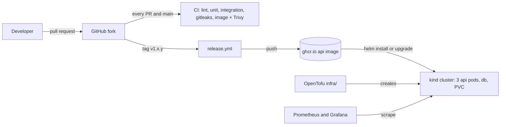
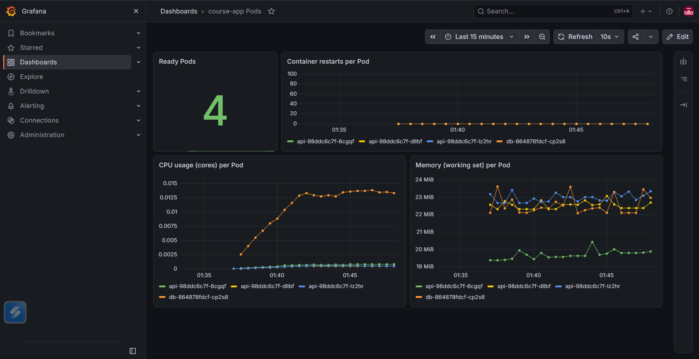

# Capstone: Ship it, run it, explain it

Fork: https://github.com/Chamalka001/turiba-devops-labs

## Run it from zero

### 1. Compose (laptop)

```bash
git clone https://github.com/Chamalka001/turiba-devops-labs.git
cd turiba-devops-labs
cp .env.example .env          # then set DB_PASSWORD in .env
docker compose up -d
# open http://localhost:8080 and add a todo
docker compose down           # add -v to also delete the database volume
```

### 2. Kubernetes with Helm (kind)

```bash
kind create cluster --name course
kubectl create namespace course
kubectl -n course create secret generic db-secret --from-literal=password='<choose-a-password>'
helm install course-app charts/course-app -n course --wait --timeout 5m
kubectl -n course get pods
```

Open the API (leave this running, use a second terminal for the next commands):

```bash
kubectl -n course port-forward svc/api 5000:80
curl localhost:5000/
curl -X POST -H 'Content-Type: application/json' -d '{"title":"hello"}' localhost:5000/api/todos
curl localhost:5000/api/todos
```

Upgrade and roll back:

```bash
helm upgrade course-app charts/course-app -n course --set api.replicas=2
helm rollback course-app 1 -n course
```

Clean up: `kind delete cluster --name course`

### 2b. The same thing from OpenTofu

`infra/` creates the kind cluster, the namespace, a random database password, the Secret and the Helm release. The first apply can take up to 5 minutes: do not press Ctrl+C.

```bash
cd infra
tofu init
tofu apply -auto-approve
kubectl -n course get pods
tofu destroy -auto-approve
```

### 3. Monitoring (Prometheus and Grafana)

```bash
helm repo add prometheus-community https://prometheus-community.github.io/helm-charts
helm repo update
helm install monitoring prometheus-community/kube-prometheus-stack \
  --version 93.11.0 -n monitoring --create-namespace \
  -f observability/kps-values.yaml --wait --timeout 10m
kubectl -n monitoring get secret monitoring-grafana -o jsonpath="{.data.admin-password}" | base64 -d; echo
kubectl -n monitoring port-forward svc/monitoring-grafana 3000:80
```

Open http://localhost:3000, log in as `admin`, then Dashboards, New, Import, and upload `observability/dashboard.json`. The first start downloads large images and can take about 7 minutes.

## Architecture



A change reaches main only through a pull request. CI runs five checks (lint, unit, integration, gitleaks, image); the image job builds the image, smoke-tests it, scans it with Trivy and pushes it from main. A tag starting with `v` makes `release.yml` push the versioned image to GHCR and create the GitHub Release. The Helm chart in `charts/course-app/` runs the API (3 replicas) and PostgreSQL (data on a PVC) on a kind cluster, with the password in a Secret that is not in Git. OpenTofu in `infra/` builds the whole cluster from code, and Prometheus with Grafana show the health of the Pods.

## What is where

| Path | What it is |
|---|---|
| `api/Dockerfile` | Multi-stage image of the API, runs as the non-root user `node` |
| `compose.yaml` | Local run: db, api and web |
| `.env.example` | Template for `.env` (the real `.env` is never committed) |
| `.github/workflows/ci.yml` | CI: lint, unit, integration, gitleaks, image with smoke test and Trivy |
| `.github/workflows/release.yml` | Builds and pushes the release image, creates the GitHub Release |
| `.github/dependabot.yml` | Weekly updates for npm, github-actions and docker |
| `.gitleaks.toml` | Secret-scan config (allows image tags that end in a commit hash) |
| `charts/course-app/` | Helm chart: API, PostgreSQL, ConfigMap, PVC, Services |
| `infra/` | OpenTofu: kind cluster, namespace, Secret, Helm release |
| `observability/` | `kps-values.yaml` (monitoring stack) and `dashboard.json` (Grafana) |
| `capstone/` | This README and the dashboard screenshot |

## Level and evidence

Level claimed: **Target**.

- M1 Containers and local dev: `api/Dockerfile`, `compose.yaml`
- M3 CI: `.github/workflows/ci.yml`
- M4 Release: https://github.com/Chamalka001/turiba-devops-labs/releases/tag/v1.0.0
- M5 Helm: `charts/course-app/`, image tag fixed to 1.0.0 in PR #34
- T1 OpenTofu: PRs #30 and #31, `infra/`
- T2 Security gates: gitleaks, Trivy and SHA pins in PR #35, Dependabot config in PR #36, Dependabot PR handled by merging #40
- T3 Observability: PR #43, `observability/dashboard.json`



Reading the dashboard: all 4 Pods are ready and none has restarted. The db Pod uses the most CPU (about 0.014 cores) while the three API Pods stay near 0.001. Memory is about 22 to 23 MiB for the db Pod and two API Pods, and about 19 to 20 MiB for the third API Pod.

## When it breaks

1. **Pod in ImagePullBackOff or ErrImagePull** (wrong image tag or no network): `kubectl -n course describe pod <pod> | tail -15`
2. **Pod in CreateContainerConfigError** (the Secret `db-secret` is missing): `kubectl -n course get secret db-secret`
3. **Pod Running but not Ready, or restarting** (the database is not ready or a probe fails): `kubectl -n course logs deploy/api --tail=30` and `kubectl -n course get pods`

## Known issues

- The first gitleaks scan of the whole history reported 6 findings. All were image tags that end in a 40-character commit hash, so I allowed that pattern in `.gitleaks.toml`. I tested that a real fake key is still detected.
- The web front end runs in Compose only, not on the cluster.
- Five Dependabot PRs are still open, including major updates (Node 26, Express 5.3), because I did not want to risk them close to the deadline.

## AI use

I used Claude as a step-by-step guide: it gave me one command at a time, I ran it and pasted the output. It helped me write the gitleaks, Trivy and Dependabot configuration, the Grafana dashboard JSON and this README. I ran every command myself and I can explain every file.
