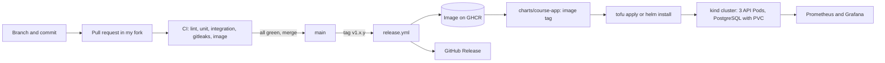

# Capstone: Ship it, run it, explain it

Fork: https://github.com/Chamalka001/turiba-devops-labs

The course todo app, from a commit to a running cluster: Compose on my laptop, CI on every pull request, a release from a tag, and Helm on a kind cluster that OpenTofu builds. Prometheus and Grafana show the health of the Pods.

## Run it from zero

Tested on 26 Nov 2026 in a new folder, with no kind clusters, on Windows 11 with WSL (Ubuntu) and Docker Desktop. You need Docker, kind, kubectl, Helm and OpenTofu.

### 1. Compose (laptop)

```bash
git clone https://github.com/Chamalka001/turiba-devops-labs.git
cd turiba-devops-labs
cp .env.example .env          # the practice password in this file is fine for a local run
docker compose up -d
docker compose ps             # db, api and web are running
# open http://localhost:8080 and add a todo
docker compose down -v        # stop it; -v also deletes the database volume
```

If you change `DB_PASSWORD` after the first run, the API answers `{"error":"internal error"}` and its log says `password authentication failed`. The old database volume still has the old password. Fix: `docker compose down -v`, then `docker compose up -d`.

### 2. Kubernetes with Helm (kind)

```bash
kind create cluster --name course
kubectl create namespace course
kubectl -n course create secret generic db-secret --from-literal=password='<choose-a-password>'
helm install course-app charts/course-app -n course --wait --timeout 5m
kubectl -n course get pods    # 3 api and 1 db, all 1/1 Running
```

Open the API (leave this running, use a second terminal for the next commands):

```bash
kubectl -n course port-forward svc/api 5000:80
curl localhost:5000/
curl -X POST -H 'Content-Type: application/json' -d '{"title":"hello"}' localhost:5000/api/todos
curl localhost:5000/api/todos
```

Upgrade and roll back:

```bash
helm upgrade course-app charts/course-app -n course --set api.replicas=2
helm rollback course-app 1 -n course
helm history course-app -n course
```

Clean up: `kind delete cluster --name course`

### 2b. The same thing from OpenTofu

`infra/` creates the kind cluster, the namespace, a random database password, the Secret and the Helm release. So there is no Secret command here. The first apply can take up to 5 minutes: do not press Ctrl+C.

```bash
cd infra
tofu init
tofu apply -auto-approve
kubectl -n course get pods
tofu destroy -auto-approve
```

On 26 Nov 2026: `tofu apply` took 2 min 15 s with the images already downloaded (the first time it depends on your internet), and `tofu destroy` took 15 s.

### 3. Monitoring (Prometheus and Grafana)

```bash
helm repo add prometheus-community https://prometheus-community.github.io/helm-charts
helm repo update
helm install monitoring prometheus-community/kube-prometheus-stack \
  --version 93.11.0 -n monitoring --create-namespace \
  -f observability/kps-values.yaml --wait --timeout 10m
kubectl -n monitoring get secret monitoring-grafana -o jsonpath="{.data.admin-password}" | base64 -d; echo
kubectl -n monitoring port-forward svc/monitoring-grafana 3000:80
```

Open http://localhost:3000, log in as `admin`, then Dashboards, New, Import, and upload `observability/dashboard.json`. The install took about 8 minutes on my laptop because of the large images. Wait 2 to 3 minutes after the import, because the CPU panel needs some data.

## Architecture



A change reaches `main` only through a pull request, and only when the required checks are green. CI runs five checks (lint, unit, integration, gitleaks, image). The image job builds the image, smoke-tests it, scans it with Trivy and pushes it from `main`. A tag that starts with `v` makes `release.yml` push the versioned image to GHCR and create the GitHub Release. The Helm chart in `charts/course-app/` names that exact image tag (now `1.0.1`). It runs the API (3 replicas) and PostgreSQL (data on a PVC) on a kind cluster, with the password in a Secret that is not in Git. OpenTofu in `infra/` builds the whole cluster from code.

## What is where

| Path | What it is |
|---|---|
| `api/Dockerfile` | Multi-stage image of the API, runs as the non-root user `node` |
| `compose.yaml`, `.env.example` | Local run: db, api and web. The real `.env` is never committed |
| `.github/workflows/ci.yml` | CI: lint, unit, integration, gitleaks, image (smoke test and Trivy) |
| `.github/workflows/release.yml` | On a `v*` tag: the multi-arch image on GHCR and the GitHub Release |
| `.github/dependabot.yml` | Weekly update PRs for npm, github-actions and docker |
| `.gitleaks.toml` | Secret-scan config (allows image tags that end in a commit hash) |
| `k8s/` | Plain manifests from Missions 7 and 8, kept for the mission checks. The chart replaced them |
| `charts/course-app/` | Helm chart: API, PostgreSQL, ConfigMap, Secret reference, PVC, Services |
| `infra/` | OpenTofu: kind cluster, namespace, Secret, Helm release |
| `observability/` | `kps-values.yaml` (monitoring stack) and `dashboard.json` (Grafana) |
| `capstone/` | This README and the dashboard screenshot |
| `lab1/` to `lab10/` | My mission write-ups |
| `lab0N-.../`, `.github/workflows/lab05-graph.yml` | Course files, not changed by me |

Course files I used: None. I wrote the manifests, the chart and the OpenTofu code myself in Missions 7 to 10.

## Level and evidence

Level claimed: **Target** (Minimum plus T1, T2 and T3). I do not claim an extension.

| Item | Evidence |
|---|---|
| M1 Containers and local dev | [api/Dockerfile](https://github.com/Chamalka001/turiba-devops-labs/blob/main/api/Dockerfile) (multi-stage, user `node`), [compose.yaml](https://github.com/Chamalka001/turiba-devops-labs/blob/main/compose.yaml). Fresh clone tested on 26 Nov 2026 |
| M2 Version control | [Ruleset protect-main](https://github.com/Chamalka001/turiba-devops-labs/rules/25671956), [all closed pull requests](https://github.com/Chamalka001/turiba-devops-labs/pulls?q=is%3Apr+is%3Aclosed) |
| M3 CI | [CI run on the last commit of main](https://github.com/Chamalka001/turiba-devops-labs/actions/runs/45815642899) (5 green checks), [ci.yml](https://github.com/Chamalka001/turiba-devops-labs/blob/main/.github/workflows/ci.yml) |
| M4 Release | [Release v1.0.0](https://github.com/Chamalka001/turiba-devops-labs/releases/tag/v1.0.0), [Release v1.0.1](https://github.com/Chamalka001/turiba-devops-labs/releases/tag/v1.0.1), [release run for v1.0.1](https://github.com/Chamalka001/turiba-devops-labs/actions/runs/45814906799), [image on GHCR](https://github.com/Chamalka001/turiba-devops-labs/pkgs/container/turiba-devops-labs%2Fapi), [release.yml](https://github.com/Chamalka001/turiba-devops-labs/blob/main/.github/workflows/release.yml) |
| M5 Kubernetes with Helm | [values.yaml](https://github.com/Chamalka001/turiba-devops-labs/blob/main/charts/course-app/values.yaml) (tag `1.0.1`), [PR #46](https://github.com/Chamalka001/turiba-devops-labs/pull/46) (chart runs 1.0.1), [PR #34](https://github.com/Chamalka001/turiba-devops-labs/pull/34) (chart runs 1.0.0), [upgrade and rollback in lab9](https://github.com/Chamalka001/turiba-devops-labs/blob/main/lab9/README.md). On 26 Nov 2026 I deleted the db Pod, and the todo was still there |
| M6 No secrets in Git | I scanned the whole history by hand on 26 Nov 2026: 94 commits, no leaks (`docker run --rm -v "$PWD:/repo" zricethezav/gitleaks:latest detect --source /repo --log-opts="--all"`). Config: [.gitleaks.toml](https://github.com/Chamalka001/turiba-devops-labs/blob/main/.gitleaks.toml). The state files are ignored by [infra/.gitignore](https://github.com/Chamalka001/turiba-devops-labs/blob/main/infra/.gitignore) |
| M7 This file | Tested from a fresh clone on 26 Nov 2026 |
| T1 Infrastructure as code | [infra/](https://github.com/Chamalka001/turiba-devops-labs/tree/main/infra), [PR #30](https://github.com/Chamalka001/turiba-devops-labs/pull/30), [PR #31](https://github.com/Chamalka001/turiba-devops-labs/pull/31), [PR #32](https://github.com/Chamalka001/turiba-devops-labs/pull/32). Apply 2 min 15 s, destroy 15 s (26 Nov 2026) |
| T2 gitleaks job | job `gitleaks` in [ci.yml](https://github.com/Chamalka001/turiba-devops-labs/blob/main/.github/workflows/ci.yml), required in the [ruleset](https://github.com/Chamalka001/turiba-devops-labs/rules/25671956), [PR #35](https://github.com/Chamalka001/turiba-devops-labs/pull/35) |
| T2 Trivy | the Trivy step in the `image` job of [ci.yml](https://github.com/Chamalka001/turiba-devops-labs/blob/main/.github/workflows/ci.yml): CRITICAL with a fix fails the job, and it runs before the push |
| T2 Dependabot | [dependabot.yml](https://github.com/Chamalka001/turiba-devops-labs/blob/main/.github/dependabot.yml), [PR #39](https://github.com/Chamalka001/turiba-devops-labs/pull/39) and [PR #40](https://github.com/Chamalka001/turiba-devops-labs/pull/40) (both made by Dependabot, merged) |
| T2 SHA pins | every action in [ci.yml](https://github.com/Chamalka001/turiba-devops-labs/blob/main/.github/workflows/ci.yml) and [release.yml](https://github.com/Chamalka001/turiba-devops-labs/blob/main/.github/workflows/release.yml) is pinned to a full commit SHA with the version in a comment. Trivy is v0.35.0, the version Aqua names as safe |
| T3 Observability | [PR #43](https://github.com/Chamalka001/turiba-devops-labs/pull/43), [dashboard.json](https://github.com/Chamalka001/turiba-devops-labs/blob/main/observability/dashboard.json), [kps-values.yaml](https://github.com/Chamalka001/turiba-devops-labs/blob/main/observability/kps-values.yaml), screenshot below |

### Grafana dashboard


Reading the dashboard: all 4 Pods are ready and none has restarted. The db Pod uses the most CPU (about 0.014 cores), while the three API Pods stay near 0.001. Memory is about 22 to 23 MiB for the db Pod and two API Pods, and about 19 to 20 MiB for the third API Pod.

## When it breaks

The three faults I think are most likely on my cluster, and the command that shows each one:

| Fault | What you see | The command that shows the cause |
|---|---|---|
| The image tag in `values.yaml` does not exist on GHCR (a typo, or the release failed) | A Pod in `ErrImagePull` or `ImagePullBackOff` | `kubectl -n course describe pod <pod> \| tail -15` (the Events say `Failed to pull image`) |
| The Secret `db-secret` is missing | A Pod in `CreateContainerConfigError` | `kubectl -n course get secret db-secret` |
| The database is not ready, or a probe fails | A Pod `Running` but not `Ready`, or restarting | `kubectl -n course logs deploy/api --tail=30` and `kubectl -n course describe pod <pod>` |

## Extension

Not claimed. I claim Target.

## Known issues

- The first gitleaks scan of the whole history reported 6 findings. All were image tags that end in a 40-character commit hash, so I allowed that pattern in `.gitleaks.toml`. I tested that a fake key is still detected.
- The gitleaks action scans only the new commits of a push or a PR. I scanned the whole history by hand (see M6).
- Some old commit messages do not follow Conventional Commits: the course commits from the lecturer, and my first Lab 1 and Lab 2 commits made in the GitHub web page. I did not rewrite history.
- After v1.0.0, Dependabot merged a small change in `api/` (a lint tool in `package.json`). So I released v1.0.1 and moved the chart to it (PR #46).
- 4 Dependabot PRs are still open (#37 Node 26, #38 trivy-action 0.36.0, #41 eslint, #42 Express 5.3). I did not want to risk major updates close to the deadline.
- The course file `lab05-graph.yml` uses two `actions/...` actions by version tag. I did not change it, because it is a course file.
- The web front end runs in Compose only, not on the cluster. The brief makes it optional.
- Once, `tofu apply` failed right after `tofu destroy` (kind did not finish creating the cluster). Nothing was left behind, and running `tofu apply` again worked.

## AI use

I used Claude as a step-by-step guide: it gave me one command at a time, I ran it and pasted the output. It helped me write the gitleaks, Trivy and Dependabot configuration, find the commit SHAs, write the Grafana dashboard JSON, check my fresh-clone test and write this README. I ran every command myself, and I can explain every file.
