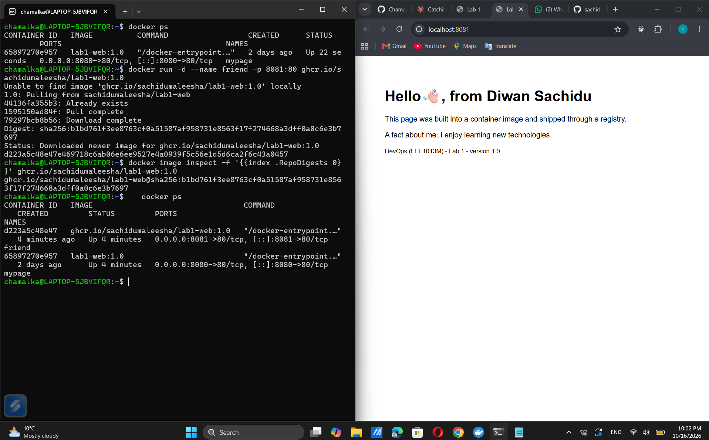

# Lab 1 · Ship it

- **Image:** `ghcr.io/chamalka001/lab1-web:1.0`
- **Digest:** `sha256:1897e1a7148c75b994cc16bd7a3d85c75171c5037088eb086f78e8596c958743`
- **Platforms:** linux/amd64, linux/arm64
- **Partner's image I ran:** `ghcr.io/sachidumaleesha/lab1-web:1.0` (digest matched: yes)



## Answers

1. **Where does the kernel used by your containers come from on your laptop? Paste the `docker info` / `uname -r` output that proves it.**

Containers don't bring their own kernel. They borrow the one from the Linux
virtual machine (WSL 2) that Docker Desktop runs inside my Windows laptop.
I tested it with an Alpine container and an Ubuntu container, and both
printed the same kernel version. Only the files on top are different.

```
Docker Desktop | kernel 6.18.54.1-microsoft-standard-WSL2 | x86_64 | 16 CPUs | 8132653056 bytes
alpine uname -r: 6.18.54.1-microsoft-standard-WSL2
ubuntu:24.04 uname -r: 6.18.54.1-microsoft-standard-WSL2
```

2. **What is the difference between `lab1-web:1.0` and `mypage`?**

`lab1-web:1.0` is the image. It's like a finished package with my page and
nginx inside, and it never changes. `mypage` is a container, a running copy
made from that image. It has its own small writable layer on top, and I can
start as many containers as I like from the same image.

3. **In Part 2 your edit to `index.html` survived `docker stop` but not `docker rm`. Why?**

Stopping a container only stops the program. The container still exists with
its writable layer, so my edited page was still there when I started it
again. `docker rm` deletes the container and that layer with it. The new
container was created fresh from the image, which I had never changed, so I
got the default "Welcome to nginx!" page again.

4. **Your page is about 1 KB, the image is tens of MB. What do you think the rest is?**

My page is tiny. Almost all of the size comes from the base image
`nginx:stable-alpine`, which contains Alpine Linux, nginx and the libraries
it needs. My `COPY` line only adds one small layer on top of that.
