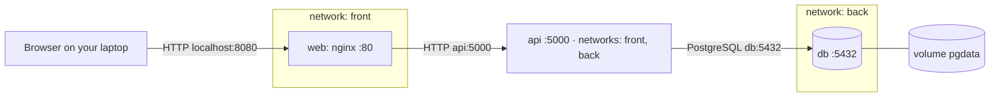

# Lab 4 · Multi-service app with Compose

GitHub user: chamalka001 · Reference files used (Lab 2 fallback): no

<!-- Keep every heading as it is: the grader finds the sections by name. Fill in every blank (four underscores) and your GitHub user name: check.sh writeup flags anything left. -->

## 1 · Architecture



Which arrow crosses from your laptop into Docker: Browser -> web, through localhost:8080

## 2 · Predictions and what happened

Part 1: fill in "I predicted" (the letter and a one-line reason) before you write any YAML. Part 3: fill in the rest. A wrong prediction that you explain earns full marks.

| # | I predicted | What I saw (command → the deciding output line) | Match? | If not: why |
|---|-------------|--------------------------------------------------|--------|-------------|
| P1 | b) nothing - web is only on the front network, and db is only on back, so web can't find the name db| docker compose exec web getent hosts db → printed nothing (but getent hosts api printed 172.19.0.2) | yes, it matches | |
| P2 | b) refused - db has no published port, so nothing on laptop listens on 5432 | nc -zv -w 3 localhost 5432 → Connection refused | yes, matched | |
| P3 | a) still there - the data is stored in a named volume, and down doesn't delete volumes | curl POST "survive me", then docker compose down and up -d --wait, then curl /api/todos → still lists "chamalka001: survive me" (id 3) | yes, matched | |
| P4 | c) the table is gone too - -v deletes the volume, so the whole database is empty again | docker compose down -v, up -d --wait db, select count(*) from todos → ERROR: relation "todos" does not exist | yes, it matches | |
| P5 | a) healthy · 500 - api’s own health check doesn’t need the database, but the request does | docker compose stop db, then docker compose ps → api still "Up (healthy)"; curl -i localhost:8080/api/todos → HTTP/1.1 500 Internal Server Error | yes, it matches | |
| P6 | b) fail: the name isn’t found - browser is on laptop, outside Docker’s network, so it can’t resolve api | reasoning from P1: my browser is on my laptop, not on a Docker network, so it can’t resolve api | yes, matched | |

## 3 · Backup and restore

```text
$ mkdir -p backup
$ docker compose exec -T db pg_dump -U todo -d todo > backup/todo.sql
$ grep 'survive me' backup/todo.sql
3       chamalka001: survive me f       2026-10-20 09:46:54.872992+00
$ docker compose down -v
[+] down 6/6
 ✔ Container course-app-web-1 Removed
 ✔ Container course-app-api-1 Removed
 ✔ Container course-app-db-1  Removed
 ✔ Volume course-app_pgdata   Removed
 ✔ Network course-app_back    Removed
 ✔ Network course-app_front   Removed
$ docker compose up -d --wait db
 ✔ Container course-app-db-1 Healthy
$ docker compose exec db psql -U todo -d todo -c 'select count(*) from todos'
ERROR:  relation "todos" does not exist
$ docker compose exec -T db psql -U todo -d todo < backup/todo.sql
SET
...
CREATE TABLE
ALTER TABLE
CREATE SEQUENCE
COPY 3
ALTER TABLE
$ docker compose up -d --wait
 ✔ Container course-app-db-1  Healthy
 ✔ Container course-app-api-1 Healthy
 ✔ Container course-app-web-1 Healthy
$ curl -s localhost:8080/api/todos
[{"id":1,"title":"Do the assignments",...},{"id":2,"title":"chamalka001: first",...},{"id":3,"title":"chamalka001: survive me",...}]
```

Why the restore must run before `api` starts: when api starts on an empty database it creates the todos table itself, so the restore would then fail with "relation todos already exists". The restore needs the database running (so psql can connect), but api must not be running yet.

## 4 · Compose clinic

### c1 (worked example)
- Error line (copied): `connect ECONNREFUSED 127.0.0.1:5432`
- Checkpoint: port, inside `api`
- Fix: `DB_HOST: db`
- Why this fix, and not the tempting one: inside `api`, `localhost` is `api` itself, and nothing listens on 5432 there. Docker's DNS answers `db` with the database container's address. Publishing `db`'s port would "work" by opening a door into the database.
- Hints used: 0

<!-- Copy the block below once for every mission you solved and change cN to c2, c3 … Then delete the cN block itself. -->

### cN
- Committed fix: `lab4/clinic/cN/`
- Error line (copied): ____
- Checkpoint (name / path / port / app / config / data): ____
- Fix: ____
- Why this fix, and not the tempting one: ____
- Hints used: ____

## 5 · Run in one command

```bash
git clone https://github.com/<you>/turiba-devops-labs.git && cd turiba-devops-labs
____
____
```

## 6 · Answers

### A1
In c1 the API logged `ECONNREFUSED 127.0.0.1:5432`. Which container was `127.0.0.1`, and why does `db` work instead?

____

### A2
Trace `POST /api/todos` from your browser to PostgreSQL: each hop, with the name and port used. Why does `db` have no `ports:`?

____

### A3
`docker compose down` kept your todos, and `docker compose down -v` deleted them. Where were they stored, and what exactly does `-v` remove?

____

### A4
With `db` stopped, `docker compose ps` showed `api` as healthy, but `/api/todos` answered 500. Explain both. What does `service_healthy` protect against, and what not?

____
